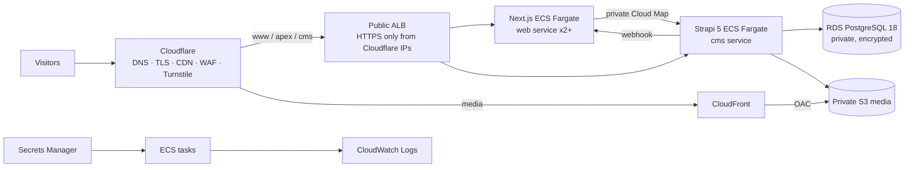

# Linkfields deployment

The production stack runs the public Next.js site and Strapi 5 separately on AWS ECS Fargate. Cloudflare is the authoritative DNS, edge TLS, CDN, WAF, and Turnstile layer. The canonical public host is `www.linkfields.com`.



## Components

The Next.js 16 service is packaged as a standalone, non-root Node 26 image and sits behind an ALB target group that probes `/api/health`. Strapi 5 runs in a separate non-root Node 26 image and is probed at `/_health`. Both tasks are in private subnets and use ECS Exec. The web service uses Cloud Map (`cms.internal.<domain>`) for server-side CMS reads, so it does not traverse the public CDN or ALB.

RDS PostgreSQL 18 is private, encrypted, backed up, storage-autoscaled, and configured to force SSL. Its master password is RDS-managed in Secrets Manager. Strapi media uses a private, versioned, encrypted S3 bucket. CloudFront can read the bucket only through an Origin Access Control; Cloudflare proxies `media.<domain>` to that distribution.

The public ALB accepts HTTP and HTTPS only from the operator-maintained Cloudflare IPv4 list. HTTP redirects to HTTPS. HTTPS routes `cms.<domain>` to Strapi and the apex/`www` hosts to Next.js. Cloudflare uses Full (strict), HSTS, TLS 1.2+, TLS 1.3, Brotli, canonical apex-to-`www` redirects, static cache rules, API/admin bypass rules, a contact endpoint WAF logging rule, and rate limiting. Turnstile validation remains in Next.js because the token is carried in the request body. Rulesets vary by plan, so `enable_cloudflare_rules` is independently switchable.

## First production deployment

1. **Prepare state and inputs.** Create a dedicated S3 bucket for Terraform state, enable versioning and encryption, then uncomment the `backend "s3"` block in `infra/terraform/versions.tf`. The native S3 lockfile (`use_lockfile = true`) avoids the legacy DynamoDB lock table. Copy `infra/terraform/terraform.tfvars.example` to `terraform.tfvars`, populate the Cloudflare zone/account IDs, and export the API token rather than writing it:

   ```bash
   export TF_VAR_cloudflare_api_token='operator-supplied-token'
   cd infra/terraform
   terraform init
   terraform plan
   ```

   The Cloudflare token needs Zone DNS Edit, Zone Settings Edit, Rulesets Edit, and, if enabled, Turnstile Sites Edit permissions. Review `cloudflare_ipv4_cidrs` against Cloudflare's published IPv4 proxy list before every infrastructure review.

2. **Create the infrastructure and images.** ECR must contain the image tags referenced by Terraform before ECS starts tasks. The safest first bootstrap is to set `web_task_count_enabled = false`, apply Terraform to create the repositories and all supporting infrastructure, build/push `latest` images, then set it to `true` and apply again:

   ```bash
   terraform apply -var='web_task_count_enabled=false'
   AWS_ACCOUNT_ID=$(aws sts get-caller-identity --query Account --output text)
   AWS_REGION=eu-west-2
   WEB_REPO=$(terraform output -raw web_ecr_repository_url)
   CMS_REPO=$(terraform output -raw cms_ecr_repository_url)
   aws ecr get-login-password --region "$AWS_REGION" | docker login --username AWS --password-stdin "$AWS_ACCOUNT_ID.dkr.ecr.$AWS_REGION.amazonaws.com"
   docker build -t "$WEB_REPO:latest" apps/web
   docker push "$WEB_REPO:latest"
   docker build -t "$CMS_REPO:latest" apps/cms
   docker push "$CMS_REPO:latest"
   terraform apply -var='web_task_count_enabled=true'
   ```

   In CI, use `.github/workflows/deploy.yml`; it uses GitHub OIDC and pushes immutable Git-SHA tags as well as `latest`. Configure the `AWS_ROLE_TO_ASSUME` environment secret and repository variables listed in the workflow. The web image gets `STRAPI_URL=https://cms.<domain>` at build time so it can prerender. It still builds if the CMS is unavailable and then renders/caches pages at runtime.

3. **Seed content once.** The seed assets are intentionally not in the CMS runtime image. Build a short-lived seed image from the CMS image; this is the simplest robust ECS option because the importer reads local asset files and uploads them through Strapi's configured S3 provider:

   ```bash
   CMS_IMAGE="$(terraform output -raw cms_ecr_repository_url):latest"
   SEED_IMAGE="$(terraform output -raw cms_ecr_repository_url):seed-$(git rev-parse --short HEAD)"
   ./infra/scripts/build-and-push-seed-image.sh "$CMS_IMAGE" "$SEED_IMAGE"
   ```

   Obtain the CMS task definition, replace the CMS container image with `SEED_IMAGE`, set `SEED_LEAD_TOKEN=1`, and run it in the private subnets with the CMS security group. The generated task needs the same database, S3, and Strapi secret injection as the CMS task definition. A reliable command is:

   ```bash
   # Save the current definition, replace image/command, and remove read-only fields before registration.
   aws ecs describe-task-definition --task-definition linkfields-production-cms --query taskDefinition --output json > /tmp/cms-task.json
   jq --arg image "$SEED_IMAGE" '
     del(.taskDefinitionArn,.revision,.status,.requiresAttributes,.compatibilities,.registeredAt,.registeredBy)
     | .containerDefinitions |= map(if .name == "cms" then .image=$image | .command=["npm","run","seed"] | .environment += [{"name":"SEED_DIR","value":"/seed"},{"name":"SEED_LEAD_TOKEN","value":"1"}] else . end)
   ' /tmp/cms-task.json >/tmp/seed-task.json
   SEED_TASK=$(aws ecs register-task-definition --cli-input-json file:///tmp/seed-task.json --query 'taskDefinition.taskDefinitionArn' --output text)
   aws ecs run-task --cluster linkfields-production --task-definition "$SEED_TASK" --launch-type FARGATE --network-configuration 'awsvpcConfiguration={subnets=[subnet-REPLACE],securityGroups=[sg-REPLACE],assignPublicIp=DISABLED}'
   ```

   Wait for the task to finish successfully and retrieve its CloudWatch log stream. Its one-time output contains `STRAPI_LEAD_TOKEN`. Put that value into the Terraform-created secret *before* deploying web tasks:

   ```bash
   aws secretsmanager put-secret-value --secret-id "$(terraform output -raw lead_token_secret_arn)" --secret-string 'printed-token-value'
   aws ecs update-service --cluster linkfields-production --service web --force-new-deployment
   ```

   Do not insert this API token in Terraform state, an image, GitHub variables, or a `.tfvars` file. The token must have only `api::lead.lead.create`.

4. **Create the first Strapi administrator.** Open `https://cms.<domain>/admin` after the CMS service is healthy and create the initial administrator through Strapi's browser flow. Keep the CMS host reachable only through Cloudflare; direct ALB origin access is blocked by the security group.

5. **Turnstile.** Set `enable_turnstile=true` and apply to create the widget. Add `terraform output -raw turnstile_site_key` as the GitHub `TURNSTILE_SITE_KEY` repository variable, then rebuild/deploy the web image. Terraform stores the corresponding server secret in Secrets Manager and injects it into the web task.

## Local development

For the complete local stack, copy the root environment template and generate distinct values:

```bash
cp .env.example .env
# Replace every generated-secret placeholder with: openssl rand -base64 32
docker compose up --build
# In another terminal, run the opt-in importer once:
docker compose --profile seed run --rm seed
```

The web service is at `http://localhost:3000` and Strapi is at `http://localhost:1337`. Compose uses a named PostgreSQL volume and a separate uploads volume. Do not use the seed profile casually against an existing environment; the importer is idempotent but uploads and updates live documents.

For no-Docker development, use a local PostgreSQL database and create `apps/cms/.env` from its template. Start Strapi with `cd apps/cms && npm run develop`. Run the web application with `cd apps/web && CONTENT_SOURCE=strapi STRAPI_URL=http://localhost:1337 pnpm dev`; for content-only UI work use `CONTENT_SOURCE=local` with `LOCAL_CONTENT_DIR` pointing to a prepared local content directory.

## Environment reference

### Next.js web

| Variable | Scope | Purpose |
|---|---|---|
| `CONTENT_SOURCE` | runtime/build | `strapi` (default) or development-only `local`. |
| `STRAPI_URL` | runtime/build | Internal CMS URL at runtime; public CMS URL during CI prerendering. |
| `STRAPI_READ_TOKEN` | runtime | Optional Strapi read token. |
| `STRAPI_LEAD_TOKEN` | runtime secret | Create-only Strapi API token used by `/api/contact`. |
| `REVALIDATE_SECRET` | runtime secret | Shared secret for Strapi's on-demand revalidation webhook. |
| `TURNSTILE_SECRET_KEY` | runtime secret | Server-side Turnstile verification key. |
| `NEXT_PUBLIC_TURNSTILE_SITE_KEY` | build/public | Browser-visible Turnstile site key. |
| `NEXT_PUBLIC_SITE_URL` | build/public | Canonical URL used for sitemap, robots, and canonical URLs. |
| `MEDIA_HOSTS` | build/runtime | Comma-separated allowed `next/image` remote media hostnames. |
| `LOCAL_CONTENT_DIR` | runtime | Local content directory when `CONTENT_SOURCE=local`. |

### Strapi CMS

| Variable group | Variables |
|---|---|
| Server/proxy | `HOST`, `PORT`, `PUBLIC_URL`, `IS_PROXIED`, `PROXY_IP_HEADER`, `PROXY_MAX_IPS_COUNT` |
| Application secrets | `APP_KEYS`, `API_TOKEN_SALT`, `ADMIN_JWT_SECRET`, `TRANSFER_TOKEN_SALT`, `ENCRYPTION_KEY`, `JWT_SECRET` |
| Database | `DATABASE_CLIENT`, `DATABASE_HOST`, `DATABASE_PORT`, `DATABASE_NAME`, `DATABASE_USERNAME`, `DATABASE_PASSWORD`, `DATABASE_URL`, `DATABASE_SSL`, `DATABASE_SSL_REJECT_UNAUTHORIZED`, `DATABASE_POOL_MIN`, `DATABASE_POOL_MAX` |
| Uploads | `UPLOAD_PROVIDER`, `AWS_BUCKET`, `AWS_REGION`, `AWS_ACL`, `CDN_URL`, `CDN_ROOT_PATH`, `UPLOAD_SIZE_LIMIT` |
| Browser/webhook | `CORS_ORIGINS`, `CSP_MEDIA_HOSTS`, `WEBSITE_REVALIDATE_URL`, `WEBSITE_REVALIDATE_SECRET` |
| Seeding | `SEED_DIR`, `SEED_LEAD_TOKEN` |

The checked-in `apps/web/.env.example` and `apps/cms/.env.example` describe every setting and deliberately contain no usable secrets.

## Operations

Use `aws logs tail /ecs/linkfields-production/web --follow` and the corresponding `/cms` group for live logs. ECS Exec is enabled for diagnosis: `aws ecs execute-command --cluster linkfields-production --task <task> --container web --interactive --command /bin/sh`. Use it sparingly; changes made in a running container are ephemeral.

The web service begins at two tasks and target-tracks 60% CPU plus 1,000 ALB requests per target. Adjust `web_min_capacity` and `web_max_capacity` through Terraform. The CMS stays at one writer task. Deployments use ECS rolling replacement and circuit-breaker rollback; the workflow waits for both services to become stable. The web health endpoint has no CMS dependency, which allows a content outage to be isolated from serving existing pages.

RDS automated backups retain fourteen days by default and storage grows from 50 GiB to 200 GiB. Test restores periodically by restoring a snapshot to a separate instance and checking application migrations. RDS deletion protection and S3 versioning are on by default. Rotate Strapi/revalidation secrets through Terraform deliberately and force new tasks; rotate the RDS password through its managed secret process. Updating the lead token is an operator action followed by a web force deployment.

Strapi publish events call the internal Next.js revalidation endpoint with `WEBSITE_REVALIDATE_SECRET`; no image rebuild is necessary for content edits. For exceptional edge cache incidents, purge the affected URL or the `/_next` cache through the Cloudflare dashboard/API. Do not broadly purge media unless an asset actually changed; S3 versioning plus long immutable cache periods are intentional.

## Indicative monthly AWS cost

Costs vary by traffic, NAT egress, RDS class, and region. A low-traffic single-NAT deployment is typically about **£170–£300/month**: two small web tasks, one 1 vCPU CMS task, an ALB, one NAT gateway, 50 GiB RDS storage, CloudWatch, and modest data transfer. A production HA NAT setup plus Multi-AZ RDS is commonly **£350–£650+/month** before significant CloudFront/NAT egress. Cloudflare plan, Route 53 is not used here, and third-party email services are outside these ranges. Review current AWS and Cloudflare pricing before approval.
