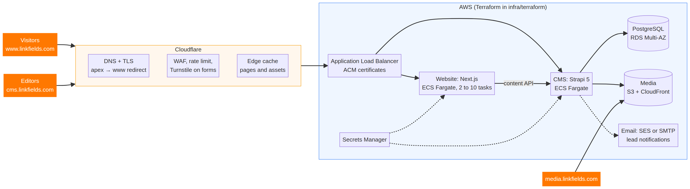
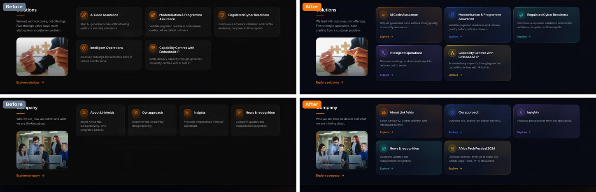

# Linkfields website: enterprise readiness and change report

**Prepared:** 9 November 2026
**Scope:** the live preview website (70 pages), the Strapi CMS, all five mega menus, conversion wording and launch readiness for the final domain
**How to read it:** items marked **Live** are already deployed on the preview site. Items marked **Proposed** need your approval or input.

---

## 1. Summary

The website is now structurally sound. This round made three changes live. All five mega menus now share one tile model. Every primary call to action now reads "Let's connect". An Africa Tech Festival (ATF) pop-up and event page invite visitors to meet Linkfields at Stand I74 from 17 to 19 November. Seventeen of the eighteen must-fix items are closed. The last one, canonical tags, is a single setting that takes effect as soon as the final domain is connected.

What separates the site from the strongest enterprise technology websites is now mostly **evidence, not design**. Buyers expect named case studies, client references, verified partner status, a visible leadership team and a trust centre their procurement team can use. Four technical launch items also remain: email notifications for new enquiries, analytics with consent, a `security.txt` file, and a redirect check at cut-over. Sections 3 and 7 explain each item, why it matters and what we need from you.

## 2. Remaining must-fix items

Items 1 to 16 and item 18 from the review are closed and verified on production: international phone numbers are accepted, every page has exactly one H1, sector meta descriptions and labels are corrected, the Machine learning page sits under Data & AI, British English is used throughout, the 404 page is branded, and the tab bar behaves correctly. The table lists what is still open, including two new findings from this round.

| # | Item | Status | What closes it |
|---|---|---|---|
| 17 | Canonical tags, sitemap and social previews use the temporary preview host | **Open, waiting for the domain** | Set `NEXT_PUBLIC_SITE_URL=https://www.linkfields.com` and rebuild. The automated checker then confirms every page |
| — | Growth-ranking wording | **Your confirmation needed** | The deck says "#35 FT & Statista Africa Growth Ranking 2026". The official 2026 table places Linkfields Innovations at rank 94. The site therefore shows the verified "#38 FT & Statista Africa's Fastest-Growing Companies 2023" |
| — | LinkedIn company URL | **Your confirmation needed** | Confirm the public company page URL used in the footer and on the event page |
| New | Great Place to Work badge on Careers | **Proposed: remove** | The badge covers India, September 2023 to September 2024, so it has expired. Replace it with a current certificate or remove it |
| New | First request to an unknown URL returns HTTP 200 | **Technical, low risk** | The branded 404 page carries `noindex`, and repeat requests return 404, so search indexing is unaffected. The fix is a path check against the CMS page list before rendering, scheduled for the domain launch |

## 3. Final domain setup: what is needed

The preview runs on a temporary sandbox host. It suits review but is not a permanent production location. The repository already contains a complete AWS and Cloudflare production design as Terraform in `infra/terraform`, shown below. Cloudflare provides DNS, TLS, edge caching, firewall rules, rate limiting on the contact endpoint and Turnstile bot protection on forms. AWS runs the website and CMS as containers behind a load balancer. Content lives in a Multi-AZ PostgreSQL database and media in S3 behind CloudFront.

| Step | Action | Owner | Notes |
|---|---|---|---|
| 1 | Confirm hostnames: **www.linkfields.com** as the canonical address with the bare domain redirecting to it; **cms.linkfields.com** for editors; **media.linkfields.com** for files | Linkfields | Already modelled in Terraform |
| 2 | Cloudflare: confirm `linkfields.com` is in Cloudflare (or move its nameservers there) and provide the zone ID, account ID and a scoped API token (DNS, zone settings, rulesets, Turnstile) | Linkfields IT | The token is passed as an environment variable and never stored in files |
| 3 | AWS: provide a production account and agree the region. The template uses London (`eu-west-2`); Cape Town (`af-south-1`) is closer to South African visitors for uncached requests | Linkfields IT and us | Set budget alerts before provisioning |
| 4 | Provision: network, load balancer, website (2 to 10 containers), CMS, PostgreSQL Multi-AZ with deletion protection, S3 and CloudFront, Secrets Manager, and TLS certificates validated through Cloudflare DNS | Us | One Terraform apply |
| 5 | Move content: copy the CMS database and uploaded media from the preview, so any edits made in the admin carry over | Us | Re-importing the seed would overwrite admin edits, so we migrate the database instead |
| 6 | Production settings: site URL (closes must-fix 17), CMS public URL, allowed origins, revalidation secret, Turnstile keys (`enable_turnstile = true`) and named editor accounts | Us | |
| 7 | Email: choose Amazon SES or your SMTP service, publish SPF, DKIM and DMARC records for `linkfields.com`, and name the recipients for new-enquiry notifications | Linkfields and us | **Enquiries are currently saved only in the CMS; nobody is emailed** |
| 8 | Protect the CMS: restrict `cms.linkfields.com` with Cloudflare Access or an IP allowlist, and give each editor an individual login | Linkfields IT and us | |
| 9 | Cut-over: lower the DNS TTL a day ahead, crawl the current linkfields.com sitemap, and confirm every old URL returns 200 or a permanent redirect. Then switch DNS and keep the redirects for at least a year | Us | The site has 63 redirects; retired pages use permanent 308 redirects and the campaign short links (`/atf`, `/events`) use temporary 307s |
| 10 | After launch: verify Google Search Console and Bing (DNS TXT records), submit the sitemap, add uptime monitoring and analytics with consent, publish `/.well-known/security.txt`, and test a backup restore | Us and Linkfields | |

Google's site-move guidance supports this sequence. It recommends permanent (301 or 308) redirects for old URLs, a self-referencing canonical tag on every new URL, and keeping redirects for "generally at least 1 year" ([Google Search Central](https://developers.google.com/search/docs/crawling-indexing/site-move-with-url-changes)). A Search Console Change of Address is only needed if the domain itself changes. Staying on `linkfields.com` does not need one.

**Timing.** For ATF visitors to land on the new site, the target is go-live by **Thursday 13 November**, with a change freeze from 14 to 19 November. The alternative is to launch the week after the festival, when the risk is lower. Both work; please tell us which you prefer.

**What we need from you:** Cloudflare and AWS access (steps 2 and 3), your email-sending choice and enquiry recipients, a security contact address for `security.txt`, your analytics preference and sign-off on the cookie notice, and the go-live date.

## 4. Menu alignment (Live)

The Services, Products & Accelerators and Industries menus used coloured accent tiles. The Solutions and Company menus did not: they used flat grey cards with orange-only icons and no link row. The different surfaces, colours and textures made the navigation feel assembled rather than designed. All five menus now use one tile model.

| Element | One standard across all five menus |
|---|---|
| Surface | The same deep-navy tile, 18 px corner radius, hairline border and soft accent wash |
| Colour | Each item carries its own accent, matching the colour of its destination page. The five portfolios keep the same colours everywhere: Digital Transformation orange, Intelligent Enterprise Platforms blue, Data & AI violet, Cyber Security teal, Talent Advisory & GCC yellow |
| Icon | One icon chip style, tinted with the item's accent. Solutions and Company received their own icons instead of reused service icons |
| Content | Title, a two-line description and an explicit "Explore" link row in the accent colour |
| Interaction | The same lift, glow and focus ring on hover and keyboard focus |
| Mobile | The drawer uses the same accent icons and link colours, so desktop and phone feel like one product |

**Why it adds value.** Usability research shows that systems are easier to learn when they "use the same patterns everywhere inside the system" ([NN/g, consistency and standards](https://www.nngroup.com/articles/consistency-and-standards/)). Stanford's credibility research found that people "quickly evaluate a site by visual design alone", and it singles out consistency ([Stanford Web Credibility](https://credibility.stanford.edu/guidelines/)). For a buyer comparing Linkfields with global integrators, a navigation system that looks designed as one piece signals the delivery discipline the site claims.

## 5. Wording changes (Live)

The site used more than twenty variants of its main call to action, such as "Discuss your challenge", "Get in touch" and "Discuss manufacturing priorities". Each led to the same form, but the label changed from page to page. The site now has one primary action, with buyer-centred titles above each contact form.

| Before | After | Where | Count |
|---|---|---|---|
| "Discuss your challenge" | **"Let's connect"** | Header button, home hero, 404 page | 3 |
| "Get in touch" | **"Let's connect"** | Page tab bars | 68 |
| 22 "Discuss …" variants | **"Let's connect"** | Tile and section buttons | 23 |
| "Discuss your …" | **"Tell us about your …"** | Contact-section titles | 35 |
| "Discuss …" | **"Talk to us about …"** | Contact-section titles | 12 |
| Contact-section label | **"Let's connect"** | Every page | 70 |
| (new) | **"Book a meeting"**, **"Plan your visit"**, **"Add to calendar"** | ATF pop-up and event page | — |

In total, 91 primary call-to-action labels now read "Let's connect", and no "Discuss…" button labels remain; the word appears only in body copy. The form still knows where the visitor came from: the area of interest is pre-selected from the page, so "Let's connect" on the SAP page opens an SAP enquiry.

**Why it adds value.** A single, recognisable primary action is easier to find, and a warmer "Let's connect" suits a partner-led sale better than "Discuss your challenge", which assumes the visitor has a problem. Research on link labels warns that "vague or repetitive links make it difficult for users to anticipate what these links lead to" ([NN/g](https://www.nngroup.com/articles/better-link-labels/)). That is why the primary action uses one label, while secondary links stay specific and the form adapts to its context. HubSpot reports that personalised calls to action convert better than basic ones ([HubSpot](https://blog.hubspot.com/marketing/personalized-calls-to-action-convert-better-data)). That figure concerns personalisation, which the pre-selected interest provides, not the wording alone.

## 6. Africa Tech Festival promotion (Live)

The pop-up, reminder banner and event page draw on your two flyers and are checked against the official festival listing. That listing confirms the expo and content sessions run 17 to 19 November 2026 at the CTICC in Cape Town, that Linkfields is a Platinum Sponsor, and that the stand is **I74**, with a capital I ([Africa Tech Festival](https://africatechfestival.com/home/sponsors/linkfields-platinum-sponsor-2026/)).

| Behaviour | How it works |
|---|---|
| Desktop | An accessible dialog opens after 4 seconds or on first scroll, featuring the CEO portrait and quote, the Platinum Sponsor badge, a "Meet us at Stand I74" block, the dates and venue, "Book a meeting", "Plan your visit" and "Add to calendar" |
| Mobile | No full-screen interruption. A slim banner ("We're at ATF 2026 · Stand I74 · CTICC") opens a bottom sheet with the same content |
| After dismissal | The dialog never reopens for that visitor; a small reminder banner remains, which they can also hide |
| Contact page | Suppressed, so the form is never covered |
| Booking | "Book a meeting" opens the contact form with "Meet us at Africa Tech Festival 2026 (Stand I74)" pre-selected |
| Calendar | "Add to calendar" downloads a calendar file for 17 to 19 November at CTICC |
| Event page | `/events/africa-tech-festival-2026`: CEO message, event facts, the five portfolios, the products, a visit plan and a booking form. The short links `/atf`, `/atf-2026` and `/events` redirect to it, so they can go on printed material |
| Expiry and control | Switches off automatically after 19 November (23:59, South African time). Every text, image, date and on/off setting is editable in the CMS under Global, Event promotion |

**Why it adds value.** CEIR research reports that 90% of exhibition attendees plan ahead and 64% search for the stands they want to visit ([CEIR via Trade Show Executive](https://tradeshowexecutive.com/new-ceir-report-outlines-digital-tactics-show-services-and-diy-marketing-effectiveness-for-exhibitor-success/)). The event page and pre-booking turn the sponsorship into scheduled conversations rather than chance footfall. The mobile design follows Google's guidance, which warns that intrusive pop-ups "may lead to poor search performance" and recommends "banners that take up only a small fraction of the screen" ([Google Search Central](https://developers.google.com/search/docs/appearance/avoid-intrusive-interstitials)).

**Proposed after the event:** turn the event page into a recap with stand photographs and a news article, and email the people who booked meetings.

## 7. Enterprise review: what to remove, rework and add

Enterprise buyers now do most of their evaluation before speaking to anyone. Gartner reports that 67% of B2B buyers prefer a rep-free experience ([Gartner, 2026](https://www.gartner.com/en/newsroom/press-releases/2026-03-09-gartner-sales-survey-finds-67-percent-of-b2b-buyers-prefer-a-rep-free-experience)). The website therefore has to answer a procurement team's questions unaided: who you are, what you have delivered, for whom, and why they can trust you. The site already does well on clarity of offer, structure, speed and accessibility basics. Mobile Largest Contentful Paint measures 1.65 s under throttled 4G and a slowed processor, inside Google's 2.5 s "good" threshold. The gaps are in proof and trust.

### 7.1 Remove (Proposed)

| # | Remove | Why | Value |
|---|---|---|---|
| 1 | The expired Great Place to Work badge on Careers (India, 2023–24) | An expired credential on display suggests the site is not maintained | Protects credibility with candidates and buyers |
| 2 | Auto-rotation in the home hero (three slides) | Usability testing shows rotating panels make even prominent content easy to miss: one user "failed to find" a 98-point headline "because the panel auto-rotated" ([NN/g](https://www.nngroup.com/articles/auto-forwarding/)) | One clear proposition; the other two messages become cards below the hero |
| 3 | Generic stock imagery in the menus and some heroes (puzzle pieces, staged meetings) | Clichéd stock photography reads as a template and weakens distinctiveness | Replace with real team, office and ATF photography or abstract brand visuals |
| 4 | Repeated "Explore" link text as the only accessible name | Five identical "Explore" links per menu are ambiguous for screen-reader users (WCAG 2.2 success criterion 2.4.4, Link Purpose) | The visual design stays the same; assistive technology announces, for example, "Explore AI Code Assurance" |
| 5 | Footer ISO badges without scope or validity | Procurement teams verify certificates, and a badge alone invites questions | Link each badge to its certificate in a trust centre, or remove it until the certificates are supplied |

### 7.2 Rework (Proposed)

- **Product pages** should move from describing capabilities to showing proof: screens, a two-minute demo video, deployment and hosting options, the licensing model, and a product-specific "Request a demo" as the secondary action.
- **Industry pages** should each gain one sector case and the regulatory context buyers in that sector ask about.
- **Careers** needs live vacancies or a link to an applicant tracking system, hiring locations and a monitored careers mailbox.
- **Insights** needs named authors, a monthly cadence aligned to the five value plays, and a place in the top navigation once there are at least twelve articles. Thought leadership matters here: 73% of decision-makers consider it a more trustworthy basis for assessing capability than marketing materials ([Edelman–LinkedIn](https://www.linkedin.com/business/marketing/blog/content-marketing/the-importance-of-b2b-thought-leadership-content-and-how-to-get-it-right)).
- **Contact** should list verified office addresses and phone numbers, which currently conflict across sources, with regional routing.
- **The home globe video** accounts for 2.66 MB of the 3.2 MB home page, or 83%. A lighter mobile version of about 1 MB, plus a poster-only fallback on data-saver connections, would cut mobile data use substantially. Vodafone measured 8% more sales from a 31% faster LCP ([web.dev](https://web.dev/case-studies/vodafone)).

### 7.3 Add: the strongest selling points (Proposed)

| # | Add | Why it sells | What we need |
|---|---|---|---|
| 1 | **Case-study library** filterable by portfolio, industry and value play, plus a "Client outcomes" band on the home page | Proof is the largest gap. Case studies work best alongside independent proof, as buyers rank user reviews among their top three resources ([TrustRadius](https://www.trustradius.com/blog/2024-b2b-buying-disconnect-the-year-of-the-brand-crisis)) | One approved case per portfolio: scope, baseline, result, period, permission |
| 2 | **Client logos and named quotes** (with permission) | 54% of software buyers speak with an existing user before buying ([TrustRadius](https://www.trustradius.com/blog/bridging-the-trust-gap-b2b-tech-buying-in-the-age-of-ai)) | Client approvals |
| 3 | **Leadership page**: names, portraits and short biographies, starting with the Founder & CEO already featured on the ATF flyers | Buyers buy from people; an anonymous company is a risk signal | Names, photographs, biographies |
| 4 | **Trust centre** (`/trust`): ISO certificates with scope and validity, the B-BBEE Level 1 certificate, POPIA and GDPR statements, sub-processors and an accessibility statement | Answers security questionnaires and procurement checks in one place. B-BBEE Level 1 is a decisive criterion in South African tenders | Certificates and approved policy text |
| 5 | **Verified partner status** for SAP, Microsoft, Salesforce, Zoho and Odoo, with tiers | Partner tier is a shortlisting filter for platform programmes | Partner evidence |
| 6 | **Enquiry handling**: email notification, routing by area of interest, CRM integration and a meeting scheduler | Every enquiry reaches the right specialist the same day | Recipients and CRM choice |
| 7 | **Analytics with consent** and conversion events (form submitted, meeting booked, event CTA) | Measures which pages and messages create pipeline. Under POPIA, cookies used for direct marketing to non-customers need consent ([Michalsons](https://www.michalsons.com/blog/cookie-law-south-africa/15264)) | Tool choice and cookie-notice sign-off |
| 8 | **Product demo assets** and a "Request a demo" action on every product page | Moves the software from claim to evidence | Screens, videos and demo-access rules |
| 9 | **Gated point-of-view papers**, one per value play, with explicit marketing opt-in | Converts research-stage visitors into known contacts. POPIA requires consent for electronic direct marketing ([Information Regulator](https://inforegulator.org.za/wp-content/uploads/2020/07/GUIDANCE-NOTE-ON-DIRECT-MARKETING-IN-TERMS-OF-THE-PROTECTION-OF-PERSONAL-INFORMATION-ACT-4-OF-2013-POPIA.pdf)) | Five papers |
| 10 | **Events hub and ATF recap** | Keeps the sponsorship working after 19 November and gives a home to future events | Photographs and a short recap |
| 11 | **`security.txt`** under `/.well-known/` | The standard way for researchers to report vulnerabilities ([RFC 9116](https://www.rfc-editor.org/rfc/rfc9116.html)); a security company should publish one | A security contact address |
| 12 | **Site search and regional office pages** | Seventy pages are more than a menu can surface; regional pages support local buyers and search | Verified addresses |

## 8. Proposed roadmap

| Stage | Timing | Work |
|---|---|---|
| 1. Launch-ready | This week, before ATF | Domain decision and cut-over plan, enquiry email notifications, analytics with consent, `security.txt`, the five removals, accessible link names, lighter mobile video |
| 2. Proof and trust | Two to four weeks | Trust centre, leadership page, verified partner badges, case-study template with the first five cases, product demo assets |
| 3. Demand engine | Ongoing | Insights cadence, gated papers, events hub, CRM integration, regional pages, a quarterly content review |

Phase 1 needs only the inputs listed in section 3. Every Phase 2 and 3 item is built on CMS components that already exist, so content can be added without design work.

## 9. Sources

1. Gartner, *Sales Survey Finds 67% of B2B Buyers Prefer a Rep-Free Experience* (2026). https://www.gartner.com/en/newsroom/press-releases/2026-03-09-gartner-sales-survey-finds-67-percent-of-b2b-buyers-prefer-a-rep-free-experience
2. TrustRadius, *2024 B2B Buying Disconnect Report*. https://www.trustradius.com/blog/2024-b2b-buying-disconnect-the-year-of-the-brand-crisis
3. TrustRadius, *Bridging the Trust Gap: B2B Tech Buying in the Age of AI* (2025). https://www.trustradius.com/blog/bridging-the-trust-gap-b2b-tech-buying-in-the-age-of-ai
4. LinkedIn and Edelman, *B2B thought leadership research* (2024 data). https://www.linkedin.com/business/marketing/blog/content-marketing/the-importance-of-b2b-thought-leadership-content-and-how-to-get-it-right
5. Nielsen Norman Group, *Auto-Forwarding Carousels and Accordions Annoy Users and Reduce Visibility*. https://www.nngroup.com/articles/auto-forwarding/
6. Nielsen Norman Group, *Maintain Consistency and Adhere to Standards*. https://www.nngroup.com/articles/consistency-and-standards/
7. Nielsen Norman Group, *Better Link Labels: 4Ss for Encouraging Clicks*. https://www.nngroup.com/articles/better-link-labels/
8. Stanford Persuasive Technology Lab, *Stanford Guidelines for Web Credibility*. https://credibility.stanford.edu/guidelines/
9. HubSpot, *Call-to-Action Statistics* (updated 2025). https://blog.hubspot.com/marketing/personalized-calls-to-action-convert-better-data
10. Google Search Central, *Avoid intrusive interstitials and dialogs*. https://developers.google.com/search/docs/appearance/avoid-intrusive-interstitials
11. Google Search Central, *How to move a site*. https://developers.google.com/search/docs/crawling-indexing/site-move-with-url-changes
12. web.dev, *Vodafone: a 31% improvement in LCP increased sales by 8%*. https://web.dev/case-studies/vodafone
13. W3C, *Web Content Accessibility Guidelines (WCAG) 2.2*. https://www.w3.org/TR/WCAG22/
14. Michalsons, *Cookie law in South Africa*. https://www.michalsons.com/blog/cookie-law-south-africa/15264
15. Information Regulator South Africa, *Guidance Note on Direct Marketing under POPIA*. https://inforegulator.org.za/wp-content/uploads/2020/07/GUIDANCE-NOTE-ON-DIRECT-MARKETING-IN-TERMS-OF-THE-PROTECTION-OF-PERSONAL-INFORMATION-ACT-4-OF-2013-POPIA.pdf
16. IETF, *RFC 9116: security.txt*. https://www.rfc-editor.org/rfc/rfc9116.html
17. Trade Show Executive, *New CEIR Report Outlines Digital Tactics…* (2024). https://tradeshowexecutive.com/new-ceir-report-outlines-digital-tactics-show-services-and-diy-marketing-effectiveness-for-exhibitor-success/
18. Africa Tech Festival, *Linkfields: Platinum Sponsor 2026*. https://africatechfestival.com/home/sponsors/linkfields-platinum-sponsor-2026/
