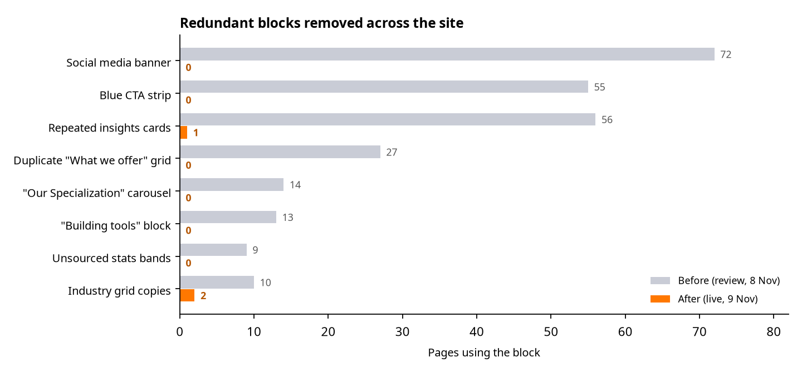
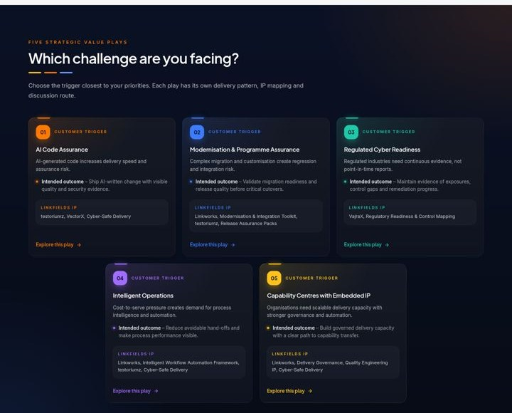
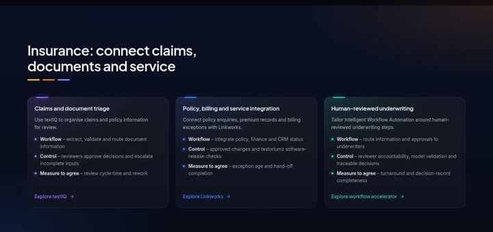

# Linkfields website: review recommendations implemented

*9 November 2026. Companion to the website review of 8 November 2026.*

---

Every recommendation from the review that did not need information from Linkfields has been implemented. The changes are live on the website and in the CMS. Each page now follows one clear template, keeps one job per section and uses only claims backed by the corporate deck or a public source. Where proof is still missing (case studies, product screens, certificates), the pages now show what Linkfields delivers and how, rather than invented results. Those inputs are listed in section 6.

| | Before (review) | Now (live) |
|---|---|---|
| Live pages | 77 | 69, with 6 new Solutions pages |
| Retired or merged pages | — | 17, with permanent redirects (60 redirects in total) |
| Pages with the social banner / blue CTA strip | 72 / 55 | 0 / 0 |
| Pages repeating the same insights cards | 56 | 1 (Home, now curated) |
| SEO issues (titles over 65 characters, weak meta descriptions) | 27 | 0 |
| Broken internal links | 2 | 0 |
| Console errors | — | 0 on all 69 pages |

## 1. Sections removed, merged or reworked

The repeated blocks listed in section 3 of the review are gone. These were the social media banner, the blue CTA strip that duplicated the contact form, the three ageing insights cards, the duplicate "What we offer" grids, the "Our Specialization" carousel, the legacy "Building tools that endure" block and the unsourced stats bands. Each page now ends with one contact section. Its next steps are specific to the page, and the area of interest is preselected.

On Home, the careers banner moved to Careers and About, and the awards carousel became one trust strip under "Who we are". The separate "Enterprise platforms" grid became a "Platforms we deliver" logo row inside the portfolio section. "Why enterprises choose Linkfields" was merged with the client-value metrics into one proof section. The hero "Our Partners" strip, which linked to the Azure portal and an AWS free-tier page, was removed.

## 2. Structure and navigation

Seventeen pages were retired or merged, each with a permanent redirect so no existing link breaks:

- **SAP:** the SAP sub-pages were consolidated into one SAP S/4HANA page, whose H1 now matches the menu.
- **Other platforms:** Odoo, Dynamics 365 and Salesforce moved under Intelligent Enterprise Platforms.
- **Talent:** Staff augmentation and Managed teams were merged into "Specialist talent & managed teams", with anchors for each.
- **Industries:** Banking, Insurance and Fintech became sections of BFSI, and Mining and Oil & Gas became sections of Energy & Mining.
- **Machine learning:** moved from Cyber Security to Data & AI.

**Solutions** now answers "Which of my problems can you solve?" with the deck's five strategic value plays. It has a new hub and five new pages: AI Code Assurance, Modernisation & Programme Assurance, Regulated Cyber Readiness, Intelligent Operations, and Capability Centres with Embedded IP. Each page covers the customer trigger, the intended outcome, the delivery architecture, the Linkfields IP involved and the commercial models. The footer now has five link columns, separate Sales and General enquiry emails, and a tagline.

## 3. Depth and consistency on every page

Each page group was reworked against the one-template-per-type standard (review section 8):

- **Portfolio pillars:** buyer outcome first, one sub-service grid, the related value plays, Linkfields IP shown with logos, and engagement models.
- **Sub-service pages:** buyer triggers and objectives, a delivery grid, a scenario or architecture, the relevant IP, secure-by-design practice, and buyer questions.
- **Product and accelerator pages:** problem and fit, real capabilities, enterprise fit (deployment, security, licensing, integrations), and one or two related items instead of the full catalogue.
- **Industry pages:** sector routes such as BFSI #banking, #insurance and #fintech, a portfolio map, visible workflow tiles (workflow, control, measure to agree), and the selected Linkfields software.
- **Company pages:** About, Our approach, Careers, Contact and the three legal pages were restructured; the legal pages are marked for counsel review.

Insights were rewritten as six current guides aligned to the portfolios, with clean URLs; the old misspelt slugs redirect. The two 2023 growth-ranking stories replace five duplicate news items.

## 4. Must-fix list: status

| # | Item | Status |
|---|---|---|
| 1 | Phone validation blocked international buyers | **Done.** Phone is optional and international (7–15 digits), with visible labels, a privacy notice and a rate-limited API |
| 2 | Contact page had no H1 | **Done.** H1 is "Contact Linkfields", with a purpose-led description |
| 3 | "We are a leading manufacturing / banking company" meta | **Done.** Rewritten as a technology partner serving each sector |
| 4 | LinkedIn admin URL; "TWITTER" label | **Done.** Public company URL, labelled X. Please confirm the URL |
| 5 | "Visit testoriumz" tab without a target | **Done.** Every tab on every page now has a target (verified) |
| 6 | SAP S/4HANA menu opened "SAP HANA" | **Done** (consolidation) |
| 7 | Machine learning still under Cyber Security | **Done.** Moved to Data & AI, with a redirect |
| 8 | "Vector X" | **Done.** VectorX throughout |
| 9 | Coca-Cola / CipherWave images as RPA vendors | **Done.** Removed |
| 10 | Copied or garbled legacy text | **Done.** Rewritten |
| 11 | Unsupported claims (10x, 60 %, guarantees, zero downtime) | **Done.** None remain |
| 12 | American spelling | **Done.** British English throughout (the only remaining hit is the correct verb "license") |
| 13 | Text repeated across pages | **Done.** Remaining repeats are intentional standard notes (licensing, illustrative-pattern disclaimers) |
| 14 | Unbranded 404 | **Done.** Branded 404 with recovery links and noindex |
| 15 | Titles and meta descriptions | **Done.** All pass. Home title: "Enterprise Technology, Software & AI \| Linkfields" |
| 16 | Blog links containing spaces | **Done.** Clean slugs, with redirects from the old ones |
| 17 | Canonical tags use the preview host | **Waiting for the final domain** (one setting) |
| 18 | Tab bar seen twice after a fast scroll | **Done.** It never shows twice, resets at the top, lands precisely and shows a fade where more tabs are hidden on mobile. Tested on 11 pages at 1440 px and 390 px |

## 5. One fact you should check: the growth ranking

The deck shows **"#35 FT & Statista Africa Growth Ranking 2026"**. In the official Statista Africa's Fastest-Growing Companies 2026 table, Linkfields Innovations is at **rank 94**; rank 35 belongs to another company. The website therefore uses the verified recognition **"#38 FT & Statista Africa's Fastest-Growing Companies 2023"**, which also matches the news coverage. Please confirm which wording you want, and correct the deck if needed.

## 6. What we need from Linkfields to go further

These items cannot be written without your evidence or approval. The pages are built to take each one in the CMS without design changes.

| Priority | Input | Where it appears |
|---|---|---|
| High | **Case studies**: one approved example per portfolio and value play, with scope, baseline, result, period and publication permission | Proof sections on pillar, solution and industry pages |
| High | **Product screens and demos** for Linkworks, testoriumz, VajraX, VectorX, textIQ, FinSight, EduPilot and AI Governance, plus demo-access rules | Product pages (currently capability-led) |
| High | **Company facts**: leadership names, bios and portraits; registered entity and founding history; current B-BBEE certificate; Great Place to Work validity (the badge we hold is India, Sept 2023 – Sept 2024) | About, footer, Careers |
| High | **Office and contact data**: verified addresses and phone numbers (UK and Botswana listings conflict; South African numbers differ) | Contact, footer |
| Medium | **Partner and certification evidence**: SAP and other OEM partner status, ISO and security certificates with scope and validity | Platform and cyber pages (badges withheld until confirmed) |
| Medium | **Service boundaries**: AMS and managed-security models, coverage hours, escalation, response commitments, NDA process | IEP, Cyber Security, Talent, Contact |
| Medium | **Product and accelerator specifics**: supported connectors, deployment and hosting, licensing, and the Linkfields layer versus Portkey/Opik in AI Governance | Product and accelerator pages |
| Medium | **Careers**: live vacancies or an ATS link, hiring locations and process, and a monitored careers mailbox | Careers |
| Medium | **Legal review**: the Information Officer and counsel should review Privacy, Terms and Cookies against the site's actual data flows | Legal pages |
| Low | **Authors and insights**: named contributors and consent, plus new articles per value play | Insights |
| Low | **Final domain, public LinkedIn URL and a media contact** | Canonical tags, footer |

## 7. Quality checks (production, 9 November)

All 69 pages return 200 and render without console errors. Each has exactly one H1, a unique title within 65 characters and a meta description of 70–165 characters, and no image lacks alt text. All 86 internal link targets resolve. The only external links that fail are FT, BusinessTech and LinkedIn, which block automated checkers but work in a browser. Redirects were spot-checked for every retired page family. The full results are in `01-post-implementation-checks.md` in this folder.

Two small technical notes. An unknown URL shows the branded 404 page with noindex, but its first, uncached request returns HTTP 200; subsequent requests return 404. This comes from the framework's streaming cache and has no effect on visitors or search indexing. The Microsoft logo in "Platforms we deliver" previously reused a pale image from the old site; it is now the full-colour logo.
