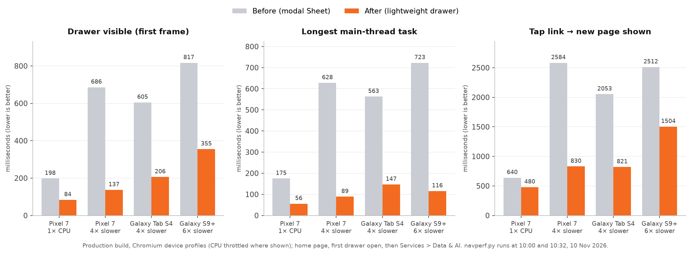

# Linkfields website — verification report

**Date:** 10 November 2026 · **Build verified:** production preview (port 3001), deployed 10:43 SAST · **Scope:** mobile responsiveness, mobile navigation performance, contact form and email notifications, Strapi content for the new hero slide and portfolios.

## 1. Summary

| Area | Result | Notes |
| --- | --- | --- |
| Mobile responsiveness (77 pages × 14 devices) | **Pass** | 1,078 page renders; no horizontal scrolling, broken images, clipped text, missing/duplicate H1, text under 11 px or undersized tap targets. Two earlier time-outs re-tested in isolation: both pages load in under 1 s. |
| Mobile navigation menu | **Pass, improved** | Root cause of a slow first open found and fixed: the drawer now appears 2.3–5× faster across the tested phone and tablet profiles. 89 of 89 drawer links reach the right page and section. |
| Contact form → CMS → email | **Pass** | Every valid enquiry stored with a unique reference and two branded emails delivered within 0.5 s; validation, spam trap and rate limit behave correctly. One input-hardening fix applied and re-tested. |
| SMTP notification templates | **Pass (test mailbox)** | Subjects, reference numbers, Reply-To, logo, links and event-specific content verified. Sending currently goes to a local test mailbox (Mailpit), not to real inboxes — see section 6. |
| Strapi content (hero + portfolios) | **Pass** | Five hero slides published, "Strategic value plays" is slide 2, 6-second autoplay. All five service portfolios, nine products and five accelerators published; 561 links checked, 0 broken. |

## 2. Mobile responsiveness

The full matrix ran every sitemap page (77) on 14 device profiles: iPhone SE, iPhone 14, iPhone 15 Pro Max, iPhone 14 landscape, Galaxy S9+, Pixel 7, iPad Mini, Galaxy Tab S4, iPad Pro 11 landscape, laptops at 1280 and 1366 px, Safari at 1440 px and desktops at 1920 and 2560 px. iPhones, iPads and desktop Safari run in WebKit (the Safari engine); Android and other desktops in Chromium.

Every profile recorded **0** pages with horizontal overflow, **0** broken images, **0** clipped headings or buttons, **0** pages without exactly one H1, **0** pages with text under 11 px and **0** pages with tap targets under 24 × 24 px. The fixed header uses 6–11 % of the screen height in portrait (21 % only in phone landscape, where the screen is 340 px tall).

Two pages timed out on iPhone 15 Pro Max during that run (`/services/intelligent-enterprise-platforms/salesforce` and `/solutions/modernisation-programme-assurance`) while other heavy test jobs were running at the same time. Re-tested alone, three loads each: HTTP 200, page loaded in 0.81–0.91 s, network idle in 1.4–2.0 s, no overflow, no broken images, one H1, no small text, no script errors. The time-outs were test-machine contention, not a page fault.

Since that run, tablets and phones in landscape (below 1024 px wide) switched from the desktop hover menu to the hamburger menu, which suits touch screens better. The three affected profiles — iPhone 14 landscape (750 × 340), iPad Mini (768 × 1024) and Galaxy Tab S4 (712 × 1138) — were re-run on all 77 pages against the final build (231 renders): all three now show the hamburger menu, with **0** problems in every category above.

## 3. Mobile navigation menu

### What was found

Below 1024 px the site uses a hamburger menu with a slide-in drawer (full width on phones, a 440 px panel on tablets). Opening it the first time was noticeably slow on lower-powered phones: one uninterrupted main-thread task of 175 ms on a Pixel 7 profile, rising to 628–723 ms with CPU throttling, during which the screen cannot respond. Tracing showed the cost was not the menu itself but the "modal" behaviour of the dialog component: it injected a scroll-lock stylesheet and set `pointer-events: none` on the page body, forcing the browser to recalculate the styles of the whole page (about 2,350 elements on the home page) twice.

### What was changed

The drawer now uses the same Radix dialog in non-modal mode inside a full-screen layer, with a lightweight page lock (the page behind cannot scroll, is hidden from screen readers, and the menu keeps keyboard focus). Escape, the close button and tapping the dimmed area all close it; focus returns to the menu button. Two WebKit-specific issues found while testing were fixed: the closing animation now always signals its end (otherwise Safari could leave an invisible layer over the page), and focus reliably returns to the menu button after closing.

| Measurement (production) | Before | After |
| --- | --- | --- |
| Tap handler, home page, first open (Pixel 7, normal CPU) | 146 ms | 28 ms |
| Tap handler, privacy policy page, repeat open | 57 ms | 12 ms |
| Drawer visible, Pixel 7 at 4× slower CPU | 686 ms | 137 ms |
| Longest task, Galaxy S9+ at 6× slower CPU | 723 ms | 116 ms |
| Tap a menu link → new page shown, Pixel 7 at 4× | 2,584 ms | 830 ms |

### Behaviour checks (production)

| Check | Chromium (Pixel 7, Galaxy S9+, Galaxy Tab S4) | WebKit (iPhone 14, iPad Mini) |
| --- | --- | --- |
| Page behind does not scroll while open | Pass | Pass |
| Keyboard focus stays inside the menu | Pass | Pass |
| Escape / close button / tap outside closes | Pass | Pass |
| Focus returns to the menu button | Pass | Pass (fixed this round) |
| Scroll position kept after closing | Pass | Pass |
| All targets at least 44 px high | Pass (0 below 44 px) | Pass |
| Menu links use fast client-side navigation | Pass | Pass |
| Header never overlaps the drawer | Pass | Pass |

All **89 of 89** drawer links (every group, item and sub-link) were clicked as a visitor would; each reached the correct page and, for section links, the correct section just below the header.

**Event pop-up interaction (fixed).** On tablets the ATF event pop-up could appear over an open menu, and on any screen over the "Let's connect" form. The pop-up now waits while another dialog is open or a form field is in use, and appears once the visitor is free (verified: not shown while the drawer was open, shown 0.4–1.6 s after it closed).

## 4. Contact form and enquiry flow

Tested end to end on production: form API → validation → Strapi lead record → reference number → visitor and sales emails.

| Test | Result |
| --- | --- |
| Valid enquiry, service interest (SAP S/4HANA) | 200; reference `LF-YYMMDD-XXXXX`; lead stored; 2 emails in ≤ 0.5 s |
| Valid enquiry, ATF event meeting request | 200; event-specific email content and calendar link |
| Valid enquiry, "Not sure — help me choose" | 200; 2 emails |
| Hostile input (HTML/script, line breaks, header-injection attempt) | 200; content escaped in both emails; no extra recipients; stored on a single line |
| Missing fields, invalid email, invalid phone, phone/country mismatch, short message, no area of interest | 422 with field-level messages |
| Malformed request | 400 |
| Spam trap (hidden field filled) | Silent 200, no lead, no email |
| Rate limit | 429 from the sixth submission in ten minutes |
| Accented and non-Latin names (Zoë Ndlovu-Müller, Devanagari, Arabic, Vietnamese) | Stored exactly as typed |

**Hardening applied this round.** Single-line fields (name, organisation, email, phone, area of interest, source page) now have line breaks, tabs, invisible control characters and text-direction override characters removed, and whitespace tidied, before anything is stored or used in an email subject. The message keeps its line breaks. Letters in every script are untouched. All test leads created during testing were deleted afterwards.

## 5. Email notification templates

| Item | Visitor confirmation | Sales notification |
| --- | --- | --- |
| Subject | `Linkfields – <enquiry type> – Ref. <reference>` | `New enquiry – <type> – <reference> – <organisation>` |
| Reply-To | sales@linkfields.com | the visitor's address |
| Content | Personal greeting, reference, summary of what was submitted, 24-hour response promise, urgent contact line | All submitted fields, source page, reference |
| Branding | Linkfields logo embedded (about 7.8 KB), brand colours | Same |
| Size / compatibility | 24–31 KB; about 94–95 % of the HTML/CSS used is fully supported across major email clients (Mailpit check) | Same |
| Links | All return 200 | All return 200 |
| Other | Marked as an automatic reply (prevents auto-responder loops) | — |

## 6. Strapi CMS content

* **Publishing:** 71 of 71 pages present and published; nothing missing, nothing extra, no unpublished draft changes.
* **Home hero:** five slides, autoplay every 6 seconds (pauses while the pointer is over the text; respects reduced-motion settings).
  1. One strategic partner across *your transformation*
  2. **We lead with *outcomes*, not offerings** — eyebrow "Strategic value plays"; five value-play chips linking to AI Code Assurance, Modernisation & Programme Assurance, Regulated Cyber Readiness, Intelligent Operations and Capability Centres with Embedded IP; button to the value-plays section on the home page (anchor verified)
  3. AI you can govern. *Code you can trust.*
  4. Global Capability Centres, *built to scale with you*
  5. Software we own. *Accelerators we reuse.*
* **Service portfolios:** Digital Transformation (6 sub-pages), Intelligent Enterprise Platforms (6), Data & AI (4), Cyber Security (4), Talent Advisory & GCC (4 pages; its two remaining menu entries are sections of an existing page) — all published.
* **Products:** Linkworks, testoriumz, textIQ, FinSight, EduPilot, VajraX, VectorX and AI Governance across four portfolio categories (nine product cards, Linkworks appearing under two portfolios), every card with its logo.
* **Accelerators:** Predictive Analytics Suite, Digital Twin Suite, Intelligent Workflow Automation, Power BI + AI/ML, Delivery accelerators.
* **Navigation:** the published menu matches the approved structure exactly.
* **Links:** 561 links in CMS content (256 unique internal targets) checked — all return 200 and every `#section` target exists.
* **Enquiry records:** 9 automated test leads were removed. Five leads from linkfields.com addresses under the name "Venu" (manual tests by the team) were kept; they can be deleted in **Content Manager → Lead** when no longer needed.

## 7. Before go-live

1. **Live email sending.** The CMS currently sends to a local test mailbox so no real emails leave the server. Configure a transactional SMTP provider (for example Microsoft 365, Amazon SES or Brevo) in the server environment, publish SPF, DKIM and DMARC records for linkfields.com, and send one controlled test to a real mailbox. Steps are in the *Installation, Access and Email Guide*.
2. **Trusted proxy for rate limiting.** The rate limit uses Cloudflare's visitor-IP header. Without Cloudflare in front, the fallback header can be supplied by the client, so production should sit behind Cloudflare (as planned) or a trusted proxy that sets it.
3. **Physical-device spot check.** Automated WebKit runs closely match Safari but are not a real iPhone. A short manual pass on one iPhone and one Android phone (open menu, expand a group, follow a link, submit the form) is recommended before launch.

## 8. Changes deployed this round

* `apps/web/src/components/layout/mobile-drawer.tsx` — lightweight non-modal drawer with page lock, WebKit-safe close animation, guaranteed focus return.
* `apps/web/src/components/layout/event-promo-client.tsx` — event pop-up waits for open dialogs and active form fields.
* `apps/web/src/app/api/contact/route.ts` — control-character and whitespace sanitising for all fields.
* `tools/nav_click_qa.py` — test tool updated for menu panels that load on first expansion.

Quality gates for the final build: ESLint 0 problems, TypeScript 0 errors, production build succeeded; website, CMS and database services healthy; all key routes 200.
